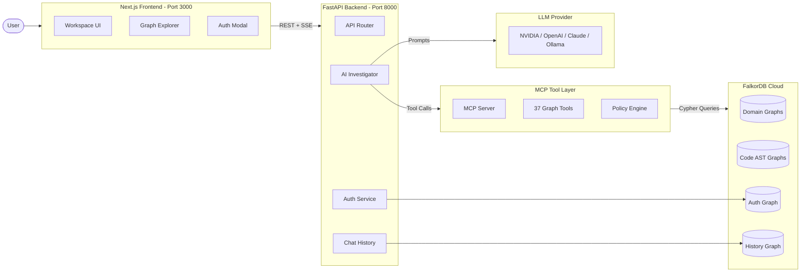
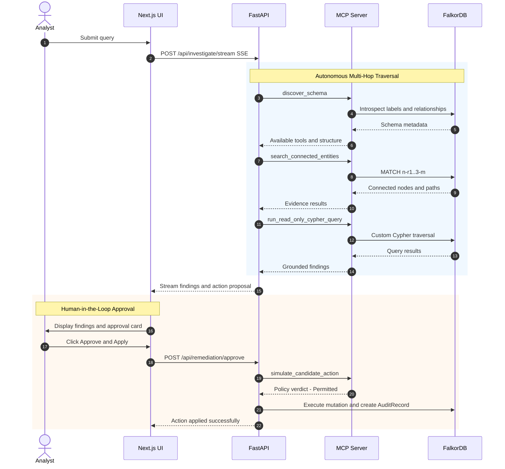
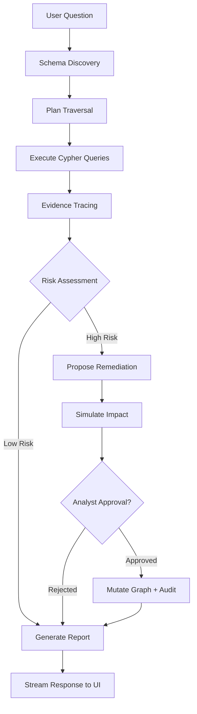
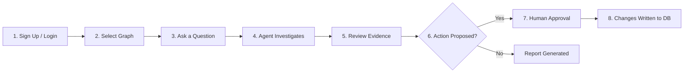
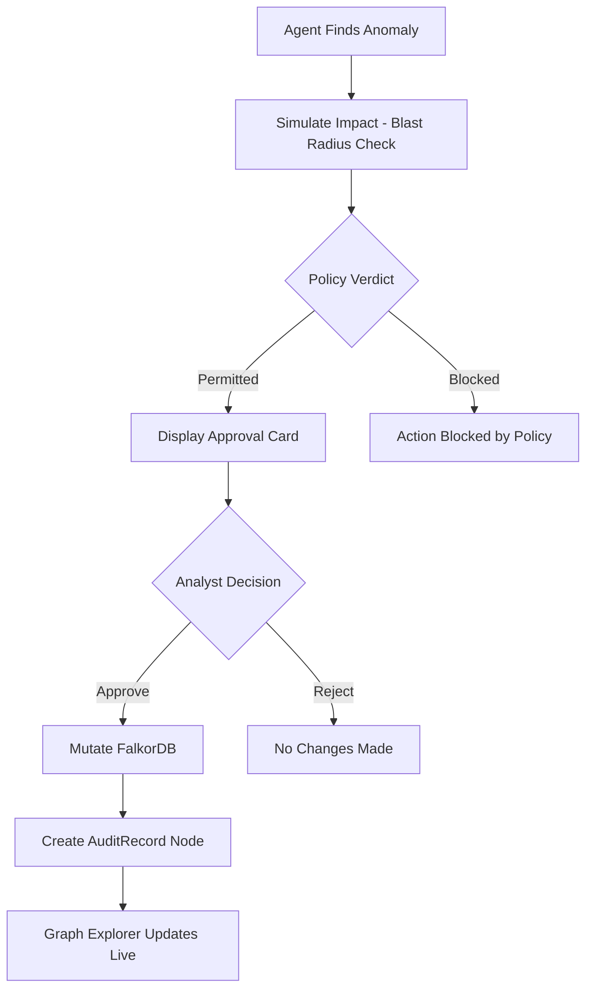
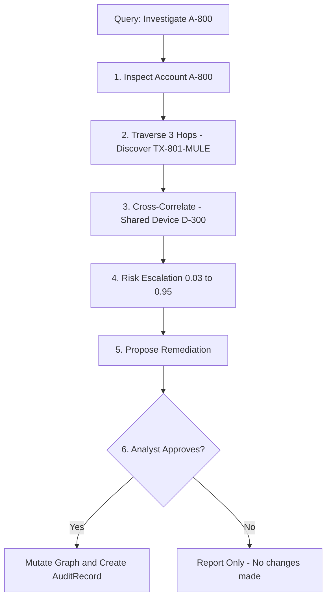
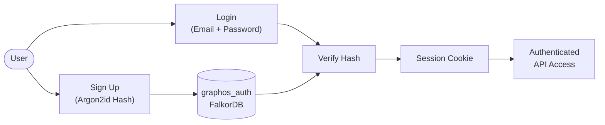

<p align="center">
  
  
  
  
  
  
</p>

# 🌌 GraphOS — AI-Powered Graph Intelligence

> **Autonomous investigation, evidence tracing, and controlled remediation over live knowledge graphs.**

---

## 🏁 Hackathon Track

> **Track 01 — Agents That Act on Connected Data**
>
> *Build an agent that uses the graph to decide and act. It could investigate fraud, triage security findings, or work through a codebase.*

| Key Focus Area | How GraphOS Delivers It |
| :--- | :--- |
| **Multi-hop reasoning** | Agent autonomously traverses 3+ hop paths across accounts, transactions, devices, and IPs to uncover hidden syndicate patterns. |
| **Graph queries and algorithms as agent tools** | 40 MCP tools including Cypher execution, PageRank, betweenness centrality, community detection, cycle detection, and connected components. |
| **Tool selection through MCP** | Agent dynamically selects tools from the MCP catalog based on the investigation context — no hardcoded tool sequences. |
| **Actions based on what the graph shows** | When evidence reaches a threshold, the agent proposes remediation (flag, suspend, escalate) based on graph-derived risk scores. |
| **Explainable results** | Every finding cites the exact Cypher query and result set that produced it — fully auditable, zero hallucination. |

---

## 📌 1. Overview

Most AI tools search flat documents or vector databases. They miss the hidden connections — shared devices, layered transaction chains, and multi-hop relationships that reveal the real story.

**GraphOS** solves this by combining a live **FalkorDB** graph database with an autonomous AI agent that reasons directly over graph structures. It discovers schemas on the fly, executes multi-hop Cypher queries, traces evidence chains to their source, and proposes remediation actions — all with **Human-in-the-Loop** approval before any mutation touches the graph.

The result: a full-stack intelligence platform where every finding is grounded in verifiable graph evidence, not hallucinated text.

---

## ✨ 2. Key Features

| Feature | Description |
| :--- | :--- |
| **🔍 Dynamic Schema Discovery** | Automatically introspects node labels, relationship types, and properties from any connected FalkorDB graph — no hardcoded schemas. |
| **🧠 Multi-Hop Reasoning** | AI agent traverses 3+ hop paths across accounts, transactions, devices, and IPs to uncover hidden patterns. |
| **🔗 Cross-Graph Correlation** | Queries span multiple graphs simultaneously (domain data, code ASTs, audit trails) to find cross-domain links. |
| **📋 Evidence Tracing** | Every claim is backed by the exact Cypher query and result set that produced it — fully auditable. |
| **🛡️ Controlled Remediation** | Proposed actions (flag account, suspend transfers) go through policy simulation and require analyst approval before execution. |
| **🕸️ Interactive Graph Explorer** | Physics-based HTML5 Canvas visualization with force simulation, clustering, path highlighting, and deep property inspection. |
| **💬 Real-Time SSE Streaming** | Watch the agent think, call tools, and build evidence in real time through Server-Sent Events. |
| **🔒 Authentication & History** | User sign-up/login with Argon2id hashing and persistent per-user chat history, all stored in FalkorDB. |
| **🌲 Code AST Ingestion** | Tree-sitter parser supporting 8 languages (Python, JS, TS, Go, Rust, Java, C/C++, PHP) for codebase graph analysis. |
| **💻 Dual Interface** | Production web app (Next.js) + interactive terminal CLI (`./graphos`). |

---

## 📸 3. Screenshots


---

## 🏗️ 4. Architecture

### High-Level System Flow



### Investigation & Remediation Sequence



### Data Flow Diagram



---

## 🗂️ Graph Data Model

GraphOS uses a flexible entity-relationship graph model stored in FalkorDB. The schema is **dynamically discovered** at runtime — no hardcoded ontology.

### Node Types (Entity Labels)

| Label | Example Properties | Description |
| :--- | :--- | :--- |
| `Account` | `id`, `name`, `status`, `risk_score` | Financial accounts under investigation |
| `Person` | `id`, `name`, `role`, `availability` | People connected to accounts, teams, or reviews |
| `Transaction` | `id`, `amount`, `currency`, `timestamp` | Money transfers between accounts |
| `Device` | `id`, `name`, `device_type` | Physical devices linked to accounts |
| `IP` | `id`, `address`, `geo_location` | Network addresses used for logins |
| `Service` | `id`, `name`, `status` | Microservices in the system |
| `Repository` | `id`, `name`, `default_branch` | Code repositories |
| `PullRequest` | `id`, `name`, `status` | Code changes under review |
| `Team` | `id`, `name` | Organizational teams |
| `Task` | `id`, `name`, `status`, `priority` | Work items (reviews, approvals) |
| `Policy` | `id`, `name`, `requirement` | Governance rules and compliance policies |
| `Incident` | `id`, `name`, `status`, `severity` | Tracked incidents |
| `AuditRecord` | `execution_id`, `action`, `timestamp` | Immutable records of approved mutations |

### Relationship Types

| Relationship | Direction | Description |
| :--- | :--- | :--- |
| `OWNS` | Person -> Account | Person owns an account |
| `TRANSFERS_TO` | Transaction -> Account | Money flows into an account |
| `LOGGED_IN_FROM` | Account -> IP | Account accessed from IP |
| `USES_DEVICE` | Account -> Device | Account linked to device |
| `DEPENDS_ON` | Service -> Service | Service dependency chain |
| `HAS_PULL_REQUEST` | Repository -> PullRequest | Repo contains a PR |
| `ASSIGNED_TO` | Task -> Person | Task is assigned to a person |
| `BLOCKED_BY` | Release -> PullRequest | Release blocked by pending PR |
| `GOVERNED_BY` | Entity -> Policy | Entity subject to policy |
| `TRACED_TO` | Incident -> Task | Incident root cause traced to task |
| `HAS_MEMBER` | Team -> Person | Team membership |
| `MODIFIES` | PullRequest -> File | PR changes a file |
| `AUTHORED_BY` | PullRequest -> Person | PR author |

### Entity-Relationship Diagram

```mermaid
erDiagram
    Account ||--o{ Transaction : receives
    Person ||--o{ Account : owns
    Account ||--o{ Device : uses
    Account ||--o{ IP : logged_in_from
    Transaction }o--|| Account : transfers_to
    Service ||--o{ Service : depends_on
    Repository ||--o{ PullRequest : has_pr
    PullRequest ||--|| Person : authored_by
    Task ||--|| Person : assigned_to
    Team ||--o{ Person : has_member
    Incident ||--|| Task : traced_to
    Policy ||--o{ Task : triggers
```



---

## 🔑 Key Cypher Queries

These are the core graph queries the agent executes through MCP tools during investigations:

### Schema Discovery
```cypher
-- Discover all node labels and counts
MATCH (n) RETURN DISTINCT labels(n), count(n)

-- Discover all relationship types
MATCH ()-[r]->() RETURN DISTINCT type(r), count(r)

-- Introspect properties per label
MATCH (n) RETURN DISTINCT labels(n), keys(n) LIMIT 100
```

### Multi-Hop Traversal (Investigation Core)
```cypher
-- Traverse 3 hops from a target entity to find connected evidence
MATCH path = (target {id: $entity_id})-[*1..3]-(connected)
RETURN nodes(path), relationships(path)

-- Find all accounts connected through shared devices
MATCH (a1:Account)-[:USES_DEVICE]->(d:Device)<-[:USES_DEVICE]-(a2:Account)
WHERE a1.id = $target_id AND a1 <> a2
RETURN a2.id, a2.name, d.id AS shared_device

-- Trace transaction flows to detect mule chains
MATCH (source:Account)-[:TRANSFERS_TO*1..4]->(dest:Account)
WHERE source.id = $source_id
RETURN source.id, dest.id, dest.status, dest.risk_score
```

### Graph Algorithms (Agent Tools)
```cypher
-- PageRank: Find most influential nodes
MATCH (source:Entity)-[r]->(target:Entity)
RETURN source.id, source.name, target.id, target.name
-- (PageRank computed in-application over this edge list)

-- Connected Components: Identify clusters
MATCH (n)-[r]-(m)
RETURN n.id, m.id, type(r)
-- (Union-Find algorithm applied in-application)

-- Betweenness Centrality: Find bridge nodes
MATCH path = shortestPath((a)-[*]-(b))
WHERE a <> b
RETURN nodes(path)
```

### Remediation (Post-Approval Mutations)
```cypher
-- Flag a suspicious account (only after human approval)
MATCH (a:Account {id: $target_id})
SET a.status = 'flagged', a.risk_score = $new_risk_score
RETURN a

-- Create immutable audit record
CREATE (:AuditRecord {
  execution_id: $exec_id,
  action: $action_type,
  target_id: $target_id,
  approved_by: $user_email,
  timestamp: datetime()
})
```

---

## 🛠️ 5. Tech Stack

| Layer | Technology |
| :--- | :--- |
| **Frontend** | Next.js 16, React 19, Tailwind CSS, TypeScript |
| **Backend** | Python 3.10+, FastAPI, Uvicorn |
| **AI Agent** | Custom multi-hop investigator with tool-calling loop |
| **Tool Layer** | Model Context Protocol (MCP) — 37 registered tools |
| **Database** | FalkorDB Cloud (Redis-compatible graph engine, Cypher queries) |
| **LLM Providers** | NVIDIA AI (`gpt-oss-20b`), OpenAI (`gpt-4o`), Anthropic (`claude-3-5-sonnet`), Ollama (local) |
| **Auth** | Argon2id password hashing, session cookies |
| **Code Parsing** | Tree-sitter (8 languages) |
| **Streaming** | Server-Sent Events (SSE) |

---

## 📁 6. Project Structure

```text
graphhacks/
│
├── agent/                          # 🧠 AI Agent & Backend
│   ├── api.py                      #    FastAPI server, SSE streaming, REST endpoints
│   ├── engine.py                   #    Multi-hop investigation loop & synthesis
│   ├── auth.py                     #    Authentication service (Argon2id, graphos_auth)
│   ├── chat_history.py             #    Persistent chat history (graphos_history)
│   ├── config.py                   #    Centralized configuration loader
│   ├── models.py                   #    Pydantic request/response models
│   ├── session.py                  #    Session tracking & audit logging
│   ├── evidence.py                 #    Evidence quality scoring & validation
│   ├── guardrails.py               #    Safety guardrails & query validation
│   ├── schema_context.py           #    Dynamic schema context builder
│   ├── mcp_client.py               #    MCP client connection manager
│   ├── cli.py                      #    Terminal CLI commands
│   ├── repl.py                     #    Interactive REPL mode
│   ├── providers/                  #    LLM provider adapters (NVIDIA, OpenAI, Claude, Ollama)
│   └── codeparser/                 #    Tree-sitter 8-language code AST parser
│
├── mcp_server/                     # 🔧 Model Context Protocol Server
│   ├── server.py                   #    MCP server with 37 registered graph tools
│   ├── db.py                       #    FalkorDB connection pool & safe query execution
│   ├── schema_discovery.py         #    Runtime schema introspection
│   ├── investigation.py            #    Graph traversal & entity search tools
│   ├── intelligence.py             #    Pattern detection & anomaly analysis
│   ├── algorithms.py               #    Graph algorithms (centrality, clustering, paths)
│   ├── decision_memory.py          #    Action proposals, approval tokens & audit trails
│   ├── counterfactual.py           #    Blast radius & impact simulation
│   ├── policy.py                   #    Safety policy verdicts & guardrail rules
│   └── evidence_quality.py         #    Evidence scoring & confidence assessment
│
├── frontend/                       # 🖥️ Next.js Web Application
│   └── src/
│       ├── app/                    #    App router (page.tsx, layout.tsx)
│       ├── components/
│       │   ├── Workspace.tsx       #    Investigation workspace & approval card
│       │   ├── GraphExplorer.tsx   #    Canvas physics-based graph visualization
│       │   ├── Hero.tsx            #    Landing page hero & CTA
│       │   ├── Navigation.tsx      #    Header navigation & status badge
│       │   ├── AuthModal.tsx       #    Sign-up / Login modal
│       │   └── ImportDatasetModal.tsx  # Drag & drop dataset ingestion
│       ├── lib/api.ts              #    API client & SSE streaming utilities
│       └── types/index.ts          #    TypeScript interface definitions
│
├── tests/                          # 🧪 Test Suites
│   ├── test_api.py                 #    API endpoint & integration tests
│   └── test_auth_history_units.py  #    Auth & history unit tests
│
├── start.sh                        # 🚀 1-command startup script (backend + frontend)
├── run.py                          # CLI code parser & database helper
├── save_to_db.py                   # AST → FalkorDB ingestion script
├── graphos                         # Executable CLI entrypoint
├── requirements.txt                # Python dependencies
├── pyproject.toml                  # Build & packaging config
├── .env.example                    # Environment variable template
├── Dockerfile                      # Container build definition
├── docker-compose.yml              # Multi-service orchestration
└── LICENSE                         # Apache 2.0 License
```

---

## 🚀 7. Installation & Setup

### Prerequisites

| Requirement | Version | Check Command |
| :--- | :--- | :--- |
| Python | 3.10 – 3.13 | `python3 --version` |
| Node.js | 18+ | `node --version` |
| npm | 9+ | `npm --version` |
| Git | Latest | `git --version` |
| FalkorDB | Cloud or local | [falkordb.com](https://falkordb.com) |
| LLM API Key | Any supported provider | See [Environment Variables](#-8-environment-variables) |

### Quick Start (Recommended)

```bash
# 1️⃣  Clone the repository
git clone https://github.com/000jas/graphhacks.git
cd graphhacks

# 2️⃣  Create Python virtual environment
python3 -m venv .venv
source .venv/bin/activate

# 3️⃣  Install Python dependencies
pip install -r requirements.txt
pip install -e .

# 4️⃣  Install frontend dependencies
cd frontend && npm install && cd ..

# 5️⃣  Configure environment variables
cp .env.example .env
# ✏️  Edit .env with your FalkorDB and LLM credentials

# 6️⃣  Launch both services (backend + frontend)
./start.sh
```

**Access the application:**

| Service | URL |
| :--- | :--- |
| 🖥️ Web App | [http://localhost:3000](http://localhost:3000) |
| 📡 API Docs | [http://localhost:8000/docs](http://localhost:8000/docs) |

**Stop:** Press `Ctrl+C` to terminate both services.

### Manual Setup (Two Terminals)

<details>
<summary>Click to expand manual setup instructions</summary>

**Terminal 1 — Backend:**
```bash
source .venv/bin/activate
uvicorn agent.api:app --host 0.0.0.0 --port 8000 --reload
```

**Terminal 2 — Frontend:**
```bash
cd frontend
npm run dev
```

**Verify backend health:**
```bash
curl http://localhost:8000/api/health
```

</details>

---

## ⚙️ 8. Environment Variables

Create a `.env` file in the project root (use `.env.example` as a template):

```dotenv
# ─── FalkorDB Cloud ──────────────────────────────────────────
FALKORDB_HOST=your-falkordb-host.cloud
FALKORDB_PORT=54637
FALKORDB_USERNAME=falkordb
FALKORDB_PASSWORD=your-falkordb-password
FALKORDB_SSL=false
GRAPHOS_GRAPH_NAME=your_graph_name

# ─── LLM Provider ────────────────────────────────────────────
LLM_PROVIDER=nvidia                          # nvidia | openai | anthropic | ollama
LLM_MODEL=openai/gpt-oss-20b
LLM_API_BASE=https://integrate.api.nvidia.com/v1
NVIDIA_API_KEY=your-nvidia-api-key

# Alternative providers (uncomment one):
# OPENAI_API_KEY=your-openai-api-key
# ANTHROPIC_API_KEY=your-anthropic-api-key
# OLLAMA_BASE_URL=http://localhost:11434

# ─── MCP Transport ───────────────────────────────────────────
MCP_TRANSPORT=stdio
MCP_SERVER_COMMAND=python
MCP_SERVER_ARGS=mcp_server/server.py
MCP_SERVER_CWD=.

# ─── Agent Configuration ─────────────────────────────────────
AGENT_MAX_ITERATIONS=10
AGENT_MAX_TOOL_CALLS=20
AGENT_TOOL_TIMEOUT_SECONDS=30

# ─── Safety Guardrails ───────────────────────────────────────
AGENT_READ_ONLY=true
AGENT_ALLOW_ACTION_EXECUTION=false
```

> ⚠️ **Never commit real secrets.** The `.env` file is in `.gitignore`. Use `.env.example` for reference.

---

## 🎯 9. Usage

### Step-by-Step Workflow



1. **Sign Up / Login** — Create an account or sign in with your registered email.
2. **Select a Graph** — Choose a connected FalkorDB graph from the dropdown (e.g. `swiftpay_unified`).
3. **Ask a Question** — Type your investigation query in natural language.
4. **Agent Investigates** — The AI autonomously traverses multi-hop paths across the graph in real time (visible via SSE streaming).
5. **Review Evidence** — Examine grounded findings, executed Cypher queries, and the visual graph explorer canvas.
6. **Action Proposed?** — If the agent detects an issue and recommends remediation (e.g. flag an account, suspend transfers), it presents an **approval card** to the analyst.
7. **Human Approval (Required)** — The agent **never** mutates the database on its own. The analyst must explicitly click **"Approve & Apply Changes to Graph"** or reject the proposal.
8. **Changes Written to DB** — Once approved, the mutation is executed directly in **FalkorDB Cloud** and an immutable `AuditRecord` node is created, permanently logging *who* approved *what* action and *when*.

> 🛡️ **Zero autonomous writes.** Every graph mutation requires explicit human approval. Rejected proposals are discarded — nothing touches the database.

### Human-in-the-Loop Approval Flow



**What gets written to FalkorDB on approval:**
- **Target node is mutated** — e.g. `Account A-800` gets `status = 'flagged'`, `risk_score = 0.95`
- **AuditRecord node is created** — immutable record with `execution_id`, `action_type`, `target_id`, `approved_by`, and `timestamp`
- **Graph Explorer refreshes** — the affected node visually updates in real time (e.g. turns red for flagged)

### Import Your Own Data

```bash
# Parse a codebase into an AST graph
python3 run.py /path/to/your/repo

# Ingest the parsed output into FalkorDB
python3 save_to_db.py output.json --graph your_graph_name
```

Or use the **Import Dataset** button in the web UI to drag-and-drop CSV/JSON files directly.

### CLI Usage

```bash
# Interactive REPL
./graphos

# One-shot query
./graphos ask "Investigate Account A-800 transaction flows"

# System diagnostics
./graphos doctor

# Check connection status
./graphos status

# List all MCP tools
./graphos tools
```

---

## 🔎 10. Example Investigation

**Query:**

> *"Investigate Account A-800: check transaction flows, detect any mule syndicate activity, and recommend remediation."*

**What GraphOS does behind the scenes:**



**Key findings the agent returns:**
- 💰 High-velocity inflow `TX-801-MULE` (₹45,000) from flagged source
- 📱 Shared mobile device `D-300` linked to known mule accounts
- 🌐 Concurrent proxy logins from suspicious IP `10.0.4.7`
- 📈 Risk score escalated from `0.03` → `0.95`
- ✅ After approval: Account flagged in FalkorDB with immutable audit trail

---

## 🔒 11. Security

### Authentication & Access Control



| Security Layer | Implementation |
| :--- | :--- |
| **Password Hashing** | Argon2id (memory-hard, GPU-resistant) |
| **Session Management** | Secure HTTP-only session cookies |
| **Tenant Isolation** | Per-user chat history in isolated graph nodes |
| **Read-Only Default** | Agent operates in read-only mode by default (`AGENT_READ_ONLY=true`) |
| **Mutation Approval** | All write operations require explicit Human-in-the-Loop approval |
| **Policy Simulation** | Actions are simulated for blast radius before execution |
| **Audit Trail** | Every approved action creates an immutable `AuditRecord` node in FalkorDB |
| **Secret Management** | Credentials never committed; `.env` is gitignored |
| **Query Guardrails** | Cypher queries validated against injection patterns before execution |

---

## 📡 12. API Reference

| Endpoint | Method | Description |
| :--- | :---: | :--- |
| `/api/health` | `GET` | Health check, DB connection, and active model status |
| `/api/graphs` | `GET` | List available FalkorDB graphs |
| `/api/schema/{graph}` | `GET` | Introspect graph schema (labels, relationships, properties) |
| `/api/auth/signup` | `POST` | Register new user (Argon2id hashing) |
| `/api/auth/login` | `POST` | Authenticate user and set session cookie |
| `/api/auth/me` | `GET` | Get current authenticated user |
| `/api/auth/logout` | `POST` | Revoke session and clear cookie |
| `/api/conversations` | `GET` | List user's conversation history |
| `/api/conversations` | `POST` | Create new conversation thread |
| `/api/investigate/stream` | `POST` | SSE streaming investigation engine |
| `/api/remediation/approve` | `POST` | Execute approved action with audit trail |
| `/api/ingest/code-json` | `POST` | Ingest parsed AST JSON into FalkorDB |
| `/api/ingest/csv` | `POST` | Ingest CSV entities and relationships |

---

## 🖥️ Local Setup Instructions

> This project runs **fully locally**. No cloud deployment is required.

```bash
# 1. Clone
git clone https://github.com/000jas/graphhacks.git
cd graphhacks

# 2. Python environment
python3 -m venv .venv
source .venv/bin/activate
pip install -r requirements.txt
pip install -e .

# 3. Frontend
cd frontend && npm install && cd ..

# 4. Configure
cp .env.example .env
# Edit .env with your FalkorDB Cloud and LLM API credentials

# 5. Launch (single command)
./start.sh

# Backend: http://localhost:8000
# Frontend: http://localhost:3000
# API Docs: http://localhost:8000/docs
```

**Requirements:** Python 3.10+, Node.js 18+, FalkorDB instance, LLM API key (NVIDIA/OpenAI/Anthropic/Ollama).

---

## 👥 Contributors & License

### Contributors

<table>
  <tr>
    <td align="center"><b>Jheel Pashine</b><br/>Ojas Dhapse</td>
  </tr>
</table>

### License

This project is distributed under the **Apache License 2.0**.

See the [`LICENSE`](LICENSE) file for full details.

---

<p align="center">
  <b>Track 01: Agents That Act on Connected Data</b><br/>
  Built with FalkorDB · MCP · Next.js · FastAPI
</p>
